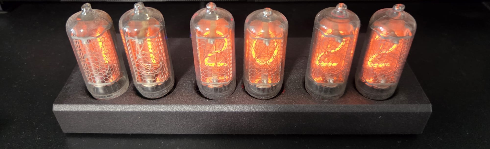
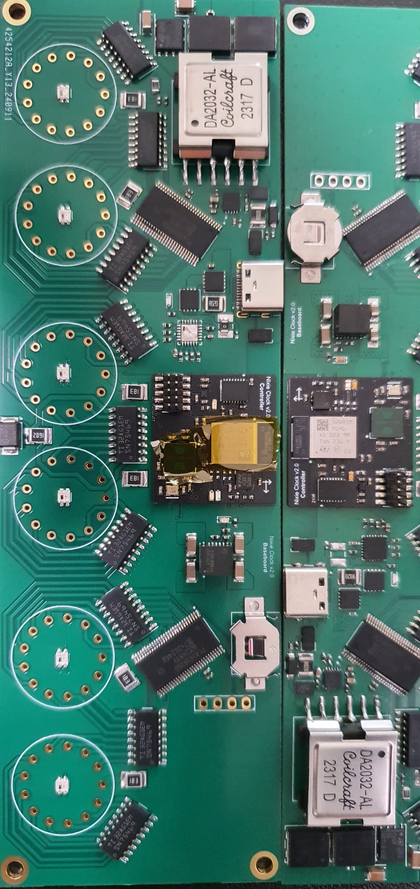
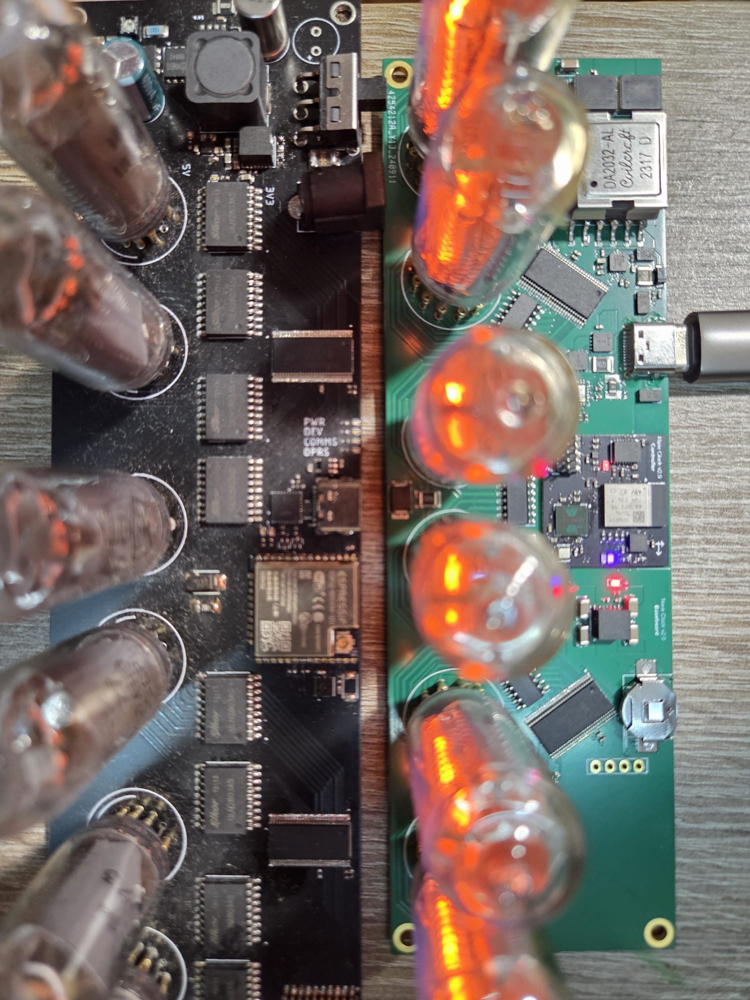
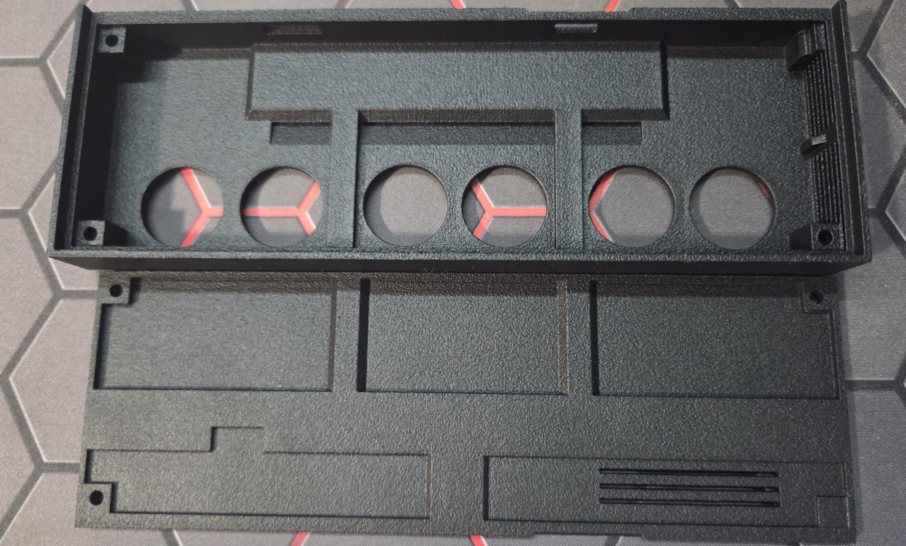

# Project Nixie 2.0

This is version two of [Project Nixie](https://github.com/devKarthikRaj/project-nixie). This one is more compact and energy efficient, and can be powered directly from USB-C (PD supported), has a human presence detection radar chip, and a BLE MCU. The board is also generally more ruggedized for longer operation. (we are pleased to report that all 3 units of the earlier project still function!)

Main features of the design:
- High efficiency 170V flyback converter
- USB-C PD input with ESD and overvoltage protection
- *Individually addressible* tube cathode drivers and RGB LEDs
- Integrated 60GHz radar (presence), IMU (tap) sensors
- High PSRR and low EMI integrated 3V3 and 5V supplies
- Temperature compensated RTC with battery backup
- STM32WB BLE application processor

## Hardware

Fig. 1: Main PCB with carrier board.

The clock PCB is depicted above in Fig. 1. The carrier board (black silkscreen) carries the main logic, while the power components are largely on the main board (green silkscreen). 

Fig. 2: Comparison with earlier version.

In Fig. 2, the design is compared with [Project Nixie](https://github.com/devKarthikRaj/project-nixie), the predecessor version. It's visually more compact and symmetrical once in the enclosure. Compared to the earlier version, the design is much more efficient, and at a room temperature is only mildly warm to the touch, measured at <45 degrees when enclosed. The earlier design could reach 60-65 degrees in the enclosure.

Fig. 3: Enclosure for the clock.

Fig. 3 shows the 3D printed enclosure, printed using SLS technology. It is simply mounted by sliding the clock in, and then screwed in with standard M3 flatheads.

## Software
The software will be updated here once it's complete.
